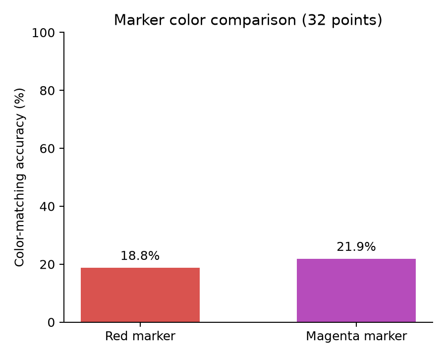
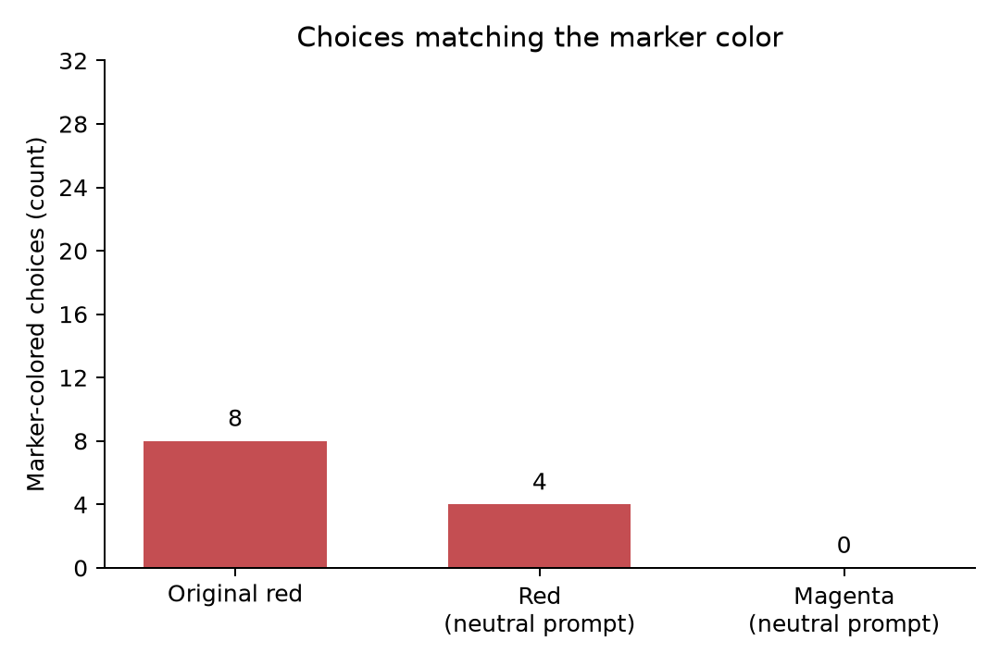
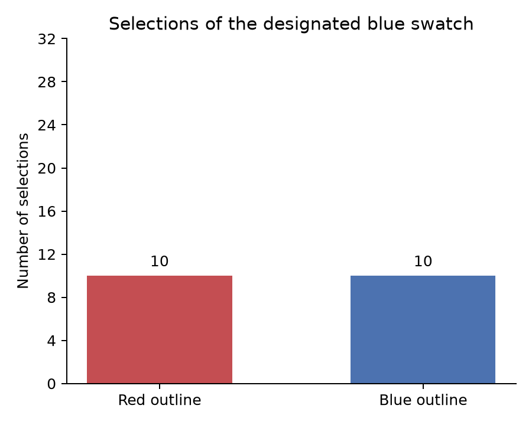
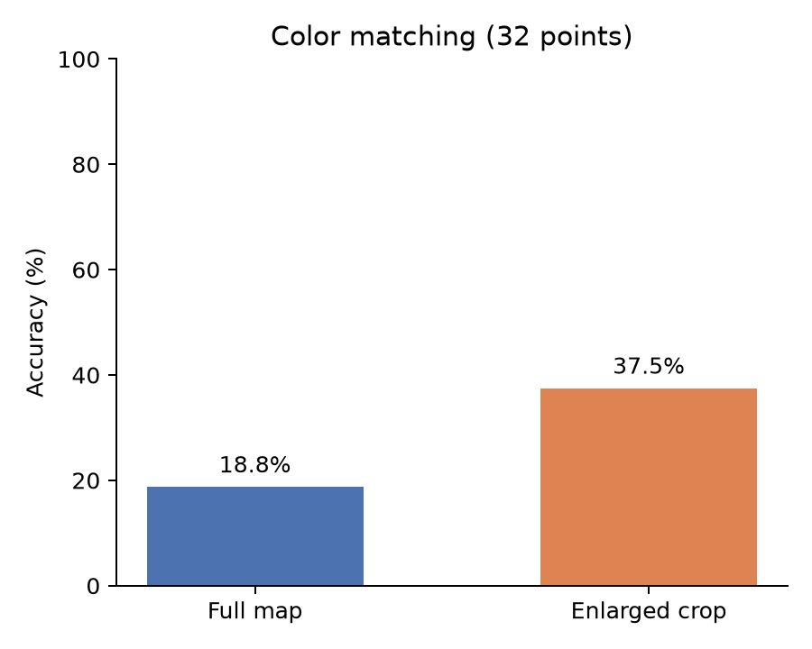
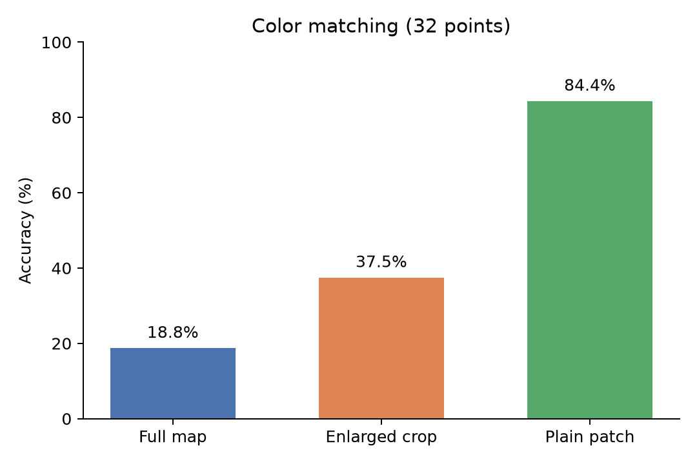
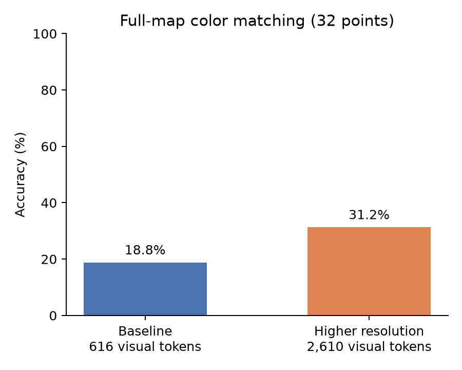
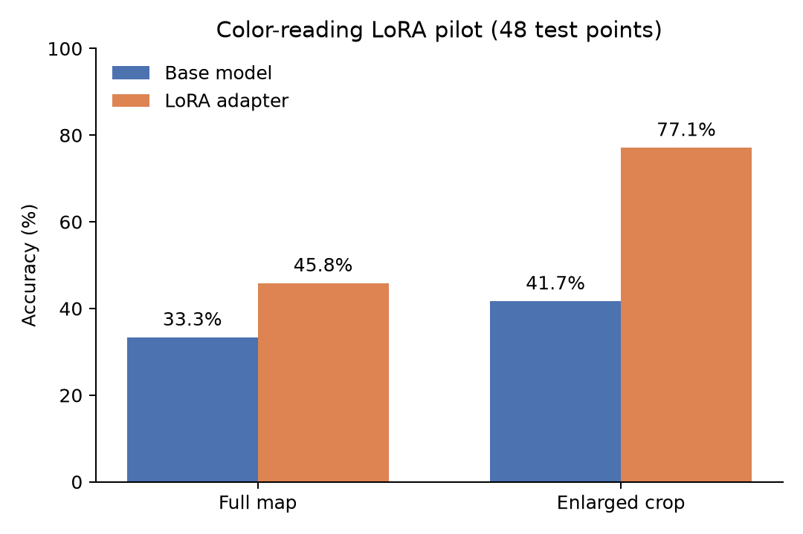
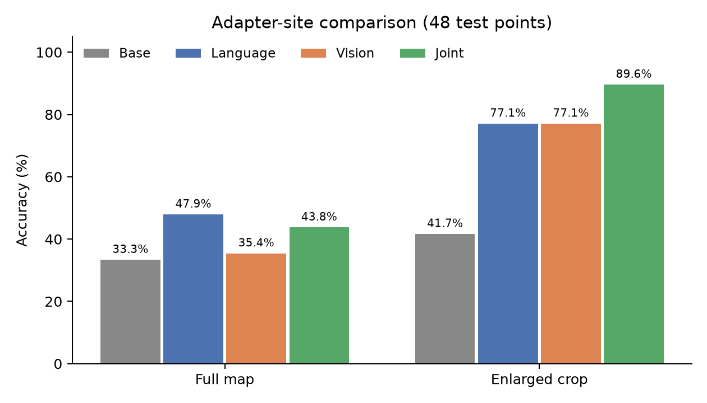

# VLM Spatial Analysis

Research question: how can a model preserve numerical relationships under specified uncertainty and answer calculations informatively?

## Experiment log

Entries below preserve the sequence of questions, methods, results, and interpretations. New follow-ups are added without replacing earlier results.

## Step 1 — Marker localization and color matching

We tested whether the unchanged VLM can locate a marker in a labeled grid and match the color underneath it, without requiring latitude/longitude or numerical map reading.

Ten real ILAMB map images, four markers each: eight development examples on two maps and **32 test examples on eight other maps**. Each image has one marker. The same points are used in both tasks; model weights are unchanged.

| Test task | Correct | Accuracy |
|---|---:|---:|
| Identify marker grid cell (6 columns × 4 rows) | 24/32 | 75% |
| Match underlying color to one of six swatches | 4/32 | 12.5% |

Twenty points had a correct grid answer but an incorrect color match; four succeeded on both tasks, eight failed both, and none succeeded only on color. All 32 color responses were valid. Uniform random selection among six swatches has expected accuracy 16.7%; this small run shows no demonstrated advantage over that reference.

**Interpretation:** coarse grid localization succeeds more often than the color-choice task. This does not isolate the internal cause: marker finding, color discrimination, and swatch-label matching can all affect color answers. Correct grid cells do not establish exact-pixel attention. Appending swatches changes the canvas. This is an exploratory diagnostic on reused maps, not a numerical-reading benchmark or a fine-tuning result.

The answer keys come from the known marker placement and source-image RGB, **not from the unresolved geographic registration of the old ILAMB benchmark**. Colored-patch screening is not a land mask. No numerical or land-validity claim is made for these diagnostics.

### Files

- `scripts/grid_localization.py`: build grid images, collect raw model answers, score grid cells.
- `scripts/color_matching.py`: build color choices, collect raw answers, and join both tasks by point ID.
- [Grid protocol](docs/grid-localization-protocol.md) and [color protocol](docs/color-matching-protocol.md): prompts, sampling, scoring, and limitations.
- [Grid examples](experiments/grid-localization-v1/preview.html) and [color examples](experiments/color-matching-v1/preview.html): frozen inputs; each directory includes `manifest.json`, `answer_key.csv`, image hashes, and PNGs.
- [Grid answers](analysis/hpc-grid-localization-v1/grid-localization-40939306/answers.csv) and [matched color answers](analysis/hpc-color-matching-v1/color-matching-40944345/matched_answers.csv): one row per point, including development and test split labels.
- Each completed run directory also contains `responses.jsonl`, `run.json`, and `summary.json`. Raw responses are preserved; invalid or missing responses count incorrect.

### Reproduce the diagnostic

Python 3.11 and a CUDA GPU supporting BF16 are recommended. Install a PyTorch build compatible with the GPU driver, then the inference requirements:

```bash
python -m pip install -r requirements/vlm.txt
# Frozen images are included; no ILAMB download is needed to run these tasks.
python scripts/grid_localization.py run \
  --dataset experiments/grid-localization-v1 --output runs/grid-new
python scripts/color_matching.py run \
  --dataset experiments/color-matching-v1 --output runs/color-new
python scripts/color_matching.py evaluate \
  --dataset experiments/color-matching-v1 --output runs/color-new \
  --grid-run runs/grid-new
```

To reproduce the published color scores from the included raw answers without a GPU:

```bash
python scripts/color_matching.py evaluate \
  --output analysis/hpc-color-matching-v1/color-matching-40944345 \
  --grid-run analysis/hpc-grid-localization-v1/grid-localization-40939306
```

The model is `Qwen/Qwen2.5-VL-7B-Instruct`, pinned to revision `cc594898137f460bfe9f0759e9844b3ce807cfb5`, with greedy decoding and 16 new tokens maximum. Actual color-run package versions and GPU are recorded in `run.json`. Dependency ranges are installation guidance, not a complete environment lock.

Rebuilding the grid dataset requires the local ILAMB `data/ilamb-gridded-v2/alignment.json` and original clean maps in `experiments/random-pairs/clean/`; these older data are not bundled here. The preparation scripts currently use the macOS Arial font path. Use the committed frozen images for exact visual reproducibility. Dataset preparation refuses to overwrite existing inputs; inference requires a new output directory.

HPC launchers are `slurm/run_grid_localization.sbatch` and `slurm/run_color_matching.sbatch`. They include a CUDA preflight; adjust the project path, account, partition, GPU, and CPU allocation for your cluster. The color launcher evaluates against the completed grid job `40939306`; change that argument when running a new grid baseline. Completed jobs: grid **40939306**, color **40944345**. The initial grid job **40936763** failed before inference and supplies no scores.

## Step 2 — Does the marker outline cause the color errors? (2026-11-05)

**Question:** Is the model choosing the red marker outline instead of the underlying map color?

**Method:** Reuse all 40 points (8 development, 32 test), showing each with red and magenta outlines. Only the colored ring pixels change; point centers, white border, map, grid, legend, swatches, and swatch order remain identical. Both conditions use the same color-neutral prompt, unchanged model checkpoint, and greedy decoding. Eighty fresh-conversation calls in HPC job **40947249**.

> Which numbered color swatch at the bottom best matches the underlying map color at the CENTER of the circular marker? Match the map color, not the marker outline or the gray grid lines. Return only one digit from 1 to 6. Do not read numerical map values or report the grid cell.

| Test condition | Correct | Accuracy |
|---|---:|---:|
| Red outline, neutral prompt | 6/32 | 18.75% |
| Magenta outline, neutral prompt | 7/32 | 21.875% |



Five test answers changed: one wrong answer became correct, four changed to other wrong answers, and no correct answer became wrong. Both conditions scored 0/8 on development examples. Red-like swatch selections (R ≥ 180, G ≤ 60, B ≤ 60) fell from four to three on the test points.

**Interpretation:** changing the outline produced only one additional correct answer (+3.125 percentage points). This small exploratory comparison does not support red-outline confusion as the main explanation for poor color matching. It does not rule out marker interference or identify the internal cause. Marker visibility and contrast also change, and magenta may have no corresponding choice.

**Keep the comparisons separate:** Step 1's red condition scored 4/32 with a prompt explicitly naming red. This follow-up reran red with a neutral prompt and scored 6/32. The controlled marker-color comparison is **6/32 versus 7/32**, not 4/32 versus 7/32. These are reused exploratory points, not a new held-out confirmation.

- [Paired results](analysis/hpc-marker-color-control-v1/marker-color-control-40947249/paired_answers.csv) · [All scored responses](analysis/hpc-marker-color-control-v1/marker-color-control-40947249/answers.csv) · [Raw responses](analysis/hpc-marker-color-control-v1/marker-color-control-40947249/responses.jsonl) · [Summary](analysis/hpc-marker-color-control-v1/marker-color-control-40947249/summary.json).
- [Experiment script](scripts/marker_color_control.py) · [Protocol](docs/marker-color-control-protocol.md) · [HPC launcher](slurm/run_marker_color_control.sbatch).
- [Matplotlib chart script](scripts/plot_marker_color_control.py); the chart reads the saved summary rather than hard-coded scores.

Regenerate the chart from the repository root:

```bash
python -m pip install -r requirements/plot.txt
python scripts/plot_marker_color_control.py
```

### How often did the model choose the marker color?



| Test (32 points each) | Selected marker-like color | Points offering that color |
|---|---:|---:|
| Original red-naming prompt, red outline | 8 | 15 |
| Neutral prompt, red outline | 4 | 15 |
| Neutral prompt, magenta outline | 0 | 0 |

These are counts of selected **color families**, not accuracy. Red-like means R ≥ 180, G ≤ 60, B ≤ 60; magenta-like means R ≥ 180, G ≤ 60, B ≥ 180. No swatch exactly equals either marker's RGB. **No magenta-like choice was available**, so zero magenta selections cannot establish that the model ignores the outline. This limits the marker-copying test; a direct test would need to offer both marker colors as choices in both conditions. All 32 outputs in each test were valid.

[Count table](analysis/hpc-marker-color-control-v1/marker_color_choices.csv) · [Matplotlib script](scripts/plot_marker_color_choices.py). Regenerate with `python scripts/plot_marker_color_choices.py`. Counts are computed from the frozen swatches and raw responses.

**Proposed next question (not run):** does enlarging the marked region improve color matching while retaining the same choices?

## Step 3 — Make the marker color an available choice (completed)

The magenta follow-up could not test direct color copying because no magenta choice existed. This follow-up changes each outline to the **exact RGB of an existing non-target blue swatch**, keeping the choices fixed. Blue shade varies by point, selected without using model responses. A red control uses the same prompt and images except the colored ring. All 40 points are paired; test analysis retains 32 points.

Primary metric: how often the SAME designated blue swatch is selected with a red ring versus a blue ring. Accuracy is secondary. This directly addresses the available-choice limitation without adding new swatches. Only marker pixels change; center and other pixels are verified unchanged.

HPC job **40949906** completed all 80 calls. All responses were downloaded and local evaluation reproduced the HPC summary exactly.

| Test condition (same 32 points) | Selected designated blue swatch |
|---|---:|
| Red outline | 10/32 |
| Outline recolored to that exact blue | 10/32 |



One point switched toward the blue option and one switched away; five answers changed overall. The other 27 predictions stayed identical. Accuracy was 6/32 with red outlines and 7/32 with blue outlines (secondary metric). Development blue-option selections were 0/8 versus 1/8; accuracy was 0/8 in both conditions.

**Interpretation:** making the outline exactly match an available blue option did not increase selection of that option in aggregate on these test points. This does not support systematic copying of the outline color as the main explanation for these errors. It does not rule out effects on individual points, and does not establish the actual failure mechanism. This is an exploratory reused sample, not proof of equivalence or a broad generalization.

[Paired results](analysis/hpc-marker-available-color-v1/marker-available-color-40949906/paired_answers.csv) · [Raw responses](analysis/hpc-marker-available-color-v1/marker-available-color-40949906/responses.jsonl) · [Summary](analysis/hpc-marker-available-color-v1/marker-available-color-40949906/summary.json) · [Protocol](docs/marker-available-color-protocol.md) · [Experiment script](scripts/marker_available_color.py) · [Chart script](scripts/plot_available_marker_choices.py).

Regenerate this chart with `python scripts/plot_available_marker_choices.py`. Next proposed diagnostic (not run): enlarge the marked region while retaining the same six choices to test sensitivity to visual scale.

## Step 4 — Enlarge the marked region (completed)

Compare full-map images with enlarged crops at all 40 existing points, keeping the red marker, six choices, their positions, image dimensions, prompt and model fixed. The 65×65 region is enlarged 5× using nearest-neighbor interpolation. Swatch pixels and underlying center RGB are verified unchanged. This jointly changes scale and surrounding context.

Primary metric: full-versus-crop color accuracy on the same 32 test points; paired improvements/regressions and missing responses reported. Eight development points remain separate. HPC job **40957950** completed all 80 calls. The job moved from the capped normal A40 queue to the authorized preemptible queue; model, inputs and scoring stayed unchanged. Downloaded raw responses and local scores reproduce the HPC summary exactly.

| Test condition | Correct | Accuracy |
|---|---:|---:|
| Full map | 6/32 | 18.75% |
| Enlarged crop | 12/32 | 37.5% |



Seven wrong answers became correct and one correct answer became wrong: net six additional successes, **+18.75 percentage points**. Seventeen predictions changed overall. Both conditions returned valid answers on all 32 test points. Across the eight maps, four improved, one regressed and three tied. Development accuracy was 0/8 versus 3/8; report it separately.

**Interpretation:** this fixed crop intervention improved six-choice color matching on these reused points, although 20/32 cropped readings were still wrong. It supports testing focused enlarged input further; it does not establish that scale alone caused the original failures, since context was removed and the ring enlarged too. No model weights changed. No numerical-legend, geographic, statistical-significance or new-test generalization claim.

[Paired answers](analysis/hpc-crop-color-matching-v1/crop-color-matching-40957950/paired_answers.csv) · [Raw responses](analysis/hpc-crop-color-matching-v1/crop-color-matching-40957950/responses.jsonl) · [Summary](analysis/hpc-crop-color-matching-v1/crop-color-matching-40957950/summary.json) · [Matplotlib script](scripts/plot_crop_color_matching.py). Regenerate with `python scripts/plot_crop_color_matching.py`.

[Protocol](docs/crop-color-matching-protocol.md) · [Script](scripts/crop_color_matching.py) · [Examples](experiments/crop-color-matching-v1/preview.html) · [Launcher](slurm/run_crop_color_matching.sbatch).

## Step 5 — Plain-color patch control (completed)

Test a large uniform square filled with each point's exact reference RGB, alongside the same six numbered swatches. Rerun full-map and crop controls using the same new conditional-target prompt for all three conditions. The 40 points and answer choices stay fixed; 120 planned calls, with 32 test points and 8 development points reported separately.

HPC job **40967775** completed all 120 calls. Raw outputs were downloaded and local evaluation reproduced the HPC summary exactly. All 32 test responses in each condition were valid.

| Input (same 32 test points) | Correct | Accuracy |
|---|---:|---:|
| Full map | 6/32 | 18.75% |
| Enlarged crop | 12/32 | 37.5% |
| Plain color patch | 27/32 | 84.375% |



Relative to the crop, the patch corrected 15 wrong answers and lost no correct answers (+46.875 percentage points). Relative to the full map, it corrected 21 and lost none (+65.625 points). Patch accuracy exceeded both other conditions on all eight test maps. Development scores were 2/8 full, 3/8 crop and 7/8 patch; development is separate.

**Interpretation:** the model can often match a large uniform color to a numbered choice, while extracting the relevant color from marked map imagery is substantially harder on these examples. This supports investigating the marked-map presentation rather than assuming complete inability to match colors or select option labels. It does not identify a unique internal bottleneck: the patch removes the marker, context and local color variation and increases uniform target area. Five patch answers still fail. Reused exploratory examples; no significance, new-test generalization, numerical-reading or model-training claim.

All three conditions were rerun under the same new conditional-target prompt. Aggregate full/crop scores happen to match Step 4, but individual predictions differ; keep this run's paired results separate.

[Paired answers](analysis/hpc-plain-patch-matching-v1/plain-patch-matching-40967775/paired_answers.csv) · [Raw responses](analysis/hpc-plain-patch-matching-v1/plain-patch-matching-40967775/responses.jsonl) · [Summary](analysis/hpc-plain-patch-matching-v1/plain-patch-matching-40967775/summary.json) · [Matplotlib script](scripts/plot_plain_patch_matching.py). Regenerate with `python scripts/plot_plain_patch_matching.py`. A strong patch result would support difficulty with marked-map presentation; a poor result would motivate checking color matching and numbered-option association. This joint intervention does not identify a unique internal mechanism.

[Protocol](docs/plain-patch-matching-protocol.md) · [Script](scripts/plain_patch_matching.py) · [Examples](experiments/plain-patch-matching-v1/preview.html) · [Launcher](slurm/run_plain_patch_matching.sbatch).

## Step 6 — Increase processor resolution (outputs complete; scheduler timed out)

Keep identical full-map PNGs, choices, prompt and model weights. Compare the previous processor settings (`min_pixels=3136`, `max_pixels=1003520`) with forced larger processing (`min_pixels=max_pixels=2007040`). Raising the cap alone is insufficient because these source images are already below it. This upsamples the same pixels rather than adding source detail.

Plan 80 paired calls on the existing 40 points, with 32 test points reported separately from development. Before inference, inspect actual processed dimensions and visual-token counts for every input and require a real token increase. Record accuracy, completion/OOMs, synchronized generation time, preprocessing time and peak GPU memory. CPU scoring checks passed. After a stalled foreground inspection, submitted HPC job **41004048** with bounded CPU threads, offline cached model files, and progress logging. Processor verification is a mandatory gate inside the job before model loading/inference; the run aborts if token counts do not increase. The uploaded script hash was verified. Job 41004048 was preempted before inference; retry **41029953** was submitted to the normal A40 queue with unchanged inputs/settings. The saved CPU processor inspection completed and was verified: baseline **784×616, 616 visual tokens** versus high **1624×1260, 2,610 visual tokens** (about 4.24×). All 80 planned inputs passed the token-increase gate. Retry **41029953 saved all 80 successful responses and a finished evaluation**, then Slurm recorded TIMEOUT at the 30-minute limit. Files were downloaded, response IDs and token counts checked, and local evaluation reproduced the HPC summary exactly. No inference is missing and no OOM occurred; keep the scheduler timeout in the provenance.

| Full-map processor setting | Processed dimensions | Visual tokens | Correct (32 test points) | Accuracy |
|---|---|---:|---:|---:|
| Baseline | 784×616 | 616 | 6/32 | 18.75% |
| Higher resolution | 1624×1260 | 2,610 | 10/32 | 31.25% |



Six wrong answers became correct and two correct answers became wrong: net four successes, **+12.5 percentage points**. Fourteen predictions changed. Four test maps improved and four tied in total correct counts. Development was 2/8 versus 3/8, reported separately.

On the test calls, mean synchronized generation time was approximately 0.278 versus 0.984 seconds; mean peak GPU allocation (including model/inputs) was 15.61 versus 16.03 GiB. Preprocessing averaged 0.0127 versus 0.0339 seconds. These are descriptive in-run measurements, not end-to-end latency or a controlled speed benchmark; first-call overhead was substantial in development, and job startup/inspection/cleanup contributed to its wall time.

**Interpretation:** allocating about 4.24× as many visual tokens improved target-color matching on these identical full-map images with unchanged weights. This supports processor resolution as a contributing presentation factor and a practical intervention to test on fresh data. It does not uniquely identify attention, prove an internal defect, add native source detail, or establish generalization. Twenty-two of 32 high-resolution answers remain wrong. This is six-choice color matching, not numerical map reading.

[Paired answers](analysis/hpc-resolution-color-matching-v1/resolution-color-matching-41029953/paired_answers.csv) · [Raw responses and measurements](analysis/hpc-resolution-color-matching-v1/resolution-color-matching-41029953/responses.jsonl) · [Summary](analysis/hpc-resolution-color-matching-v1/resolution-color-matching-41029953/summary.json) · [Matplotlib script](scripts/plot_resolution_color_matching.py). Regenerate with `python scripts/plot_resolution_color_matching.py`.

[Protocol](docs/resolution-color-matching-protocol.md) · [Script](scripts/resolution_color_matching.py) · [Launcher](slurm/run_resolution_color_matching.sbatch).

## Step 7 — Train a color-reading LoRA adapter (completed)

Question: does targeted adaptation improve full-map color reading on source groups excluded from training? Train language self-attention q/v LoRA adapters (rank 8, alpha 16), freezing the visual encoder and all original model weights. Use full-map/crop pairs as supervised examples of the same correct swatch. This is paired data augmentation, not an explicit representation-alignment loss or proof that language layers caused the failure.

Group-disjoint split from the local ILAMB archive: six train groups (288 images), two development groups (32 images), three test groups (96 images: 48 full maps and 48 crops). All eleven groups were excluded from the recent diagnostic series; the older archived benchmark may include them. Test points are newly sampled, with no test feedback used to design or select the adapter. True labels are source-image RGB, not geographic or NetCDF values. Stable colored pixels are not independently verified land locations.

One fixed epoch, LR 1e-4, batch one, gradient accumulation four, 72 planned optimizer updates. Assistant-answer tokens only; gradient checkpointing; no quantization. Both base and adapted models use the same baseline processor resolution, prompt, examples and greedy generation. Primary endpoint is full-map accuracy on 48 test points, with crop accuracy secondary and per-source counts. Only THREE held-out groups: a small exploratory pilot, not broad generalization evidence.

Smoke **41030910** passed two-train-image gradient/memory/save-reload checks using development evaluation only. Full job **41030911** completed after the smoke gate, starting fresh from the original base. Downloaded raw responses, training logs and adapter hashes were verified, and local scoring reproduced the HPC summary exactly. The test split was excluded from smoke and training. Final epoch only; no dev/test checkpoint selection.

| Input on the new 48-point test set | Base model | Saved LoRA adapter |
|---|---:|---:|
| Full map (primary) | 16/48 — 33.3% | 22/48 — 45.8% |
| Enlarged crop (secondary) | 20/48 — 41.7% | 37/48 — 77.1% |



Full maps gained six correct answers (+12.5 percentage points): 14 failures became correct while eight correct answers regressed. Two test source groups improved and one tied in total correct counts. Crops gained 17 correct answers (+35.4 points): 19 improved and two regressed; all three groups improved. Both models produced valid answers for all 96 test images.

Only **2,523,136 adapter parameters** were trainable; original and visual-encoder parameters were frozen. All 288 microsteps / 72 optimizer updates used training images. Saved adapter was reloaded for evaluation. Development token loss fell from 0.611 to 0.118; this is a training diagnostic, not test accuracy. Peak GPU allocation was about 16.89 GiB.

**Interpretation:** this fixed adapter pilot improved color-choice accuracy on source groups excluded from training, with a larger gain on crops than full maps. Full-map accuracy remains below 50%, so this has not solved the original task. Three test source groups and one seed support only a preliminary result, not broad generalization or an identified internal mechanism. These 48 test points are different from the earlier 32-point diagnostic set; compare base and adapted WITHIN this run. No numerical legend, geolocation or new-method claim.

[Paired answers](analysis/hpc-color-sft-v1/color-sft-41030911/paired_answers.csv) · [Raw responses](analysis/hpc-color-sft-v1/color-sft-41030911/responses.jsonl) · [Training log](analysis/hpc-color-sft-v1/color-sft-41030911/training.jsonl) · [Training scope](analysis/hpc-color-sft-v1/color-sft-41030911/training_scope.json) · [Summary](analysis/hpc-color-sft-v1/color-sft-41030911/summary.json) · [Chart script](scripts/plot_color_sft_results.py).

Regenerate the figure with `python scripts/plot_color_sft_results.py`. The saved adapter is at `analysis/hpc-color-sft-v1/color-sft-41030911/adapter/`.

[Protocol](docs/color-sft-protocol.md) · [Dataset builder](scripts/prepare_color_sft.py) · [Trainer/evaluator](scripts/color_sft_pilot.py) · [Examples](experiments/color-sft-v1/preview.html) · [Submission](analysis/hpc-color-sft-v1/submission.json).

## Step 8 — Compare language, vision and joint adapters (completed)

Use the unchanged color-SFT split, images, prompt, baseline resolution, one-epoch budget and evaluation. Compare fresh language-only LoRA (text q/v), vision-only LoRA (visual block fused qkv and output projection), and their union. Every original weight remains frozen; adapters are the only learned parameters. Equal rank/data/updates do not equalize trainable counts or compute, so report both. The test groups have already been inspected; this is an exploratory follow-up.

One planned A40 workflow runs all three two-image, development-only smoke tests first, verifying intended trainable modules, nonzero gradients and adapter changes in each intended subsystem, memory and save/reload. Only then run the three full models from the original checkpoint and evaluate base/saved adapters on the same held-out full/crop inputs. A failure stops the workflow. Six CPU adapter-selection/masking tests passed. **Job 41037688 completed** all three smoke tests and all three fresh training runs from frozen snapshot `adapter-sites-dc6f0ae7f0f0`. Downloaded raw answers, training logs, adapter hashes and intended-subsystem gradient/norm checks were verified. Every per-run summary and the aggregate comparison reproduced locally; repeated base predictions agreed exactly (zero disagreements).

| Model | Full map (primary, 48 points) | Enlarged crop (secondary, same 48 points) | Trainable parameters |
|---|---:|---:|---:|
| Unchanged base | 16/48 — 33.3% | 20/48 — 41.7% | 0 |
| Language LoRA | 23/48 — 47.9% | 37/48 — 77.1% | 2,523,136 |
| Vision LoRA | 17/48 — 35.4% | 37/48 — 77.1% | 1,966,080 |
| Joint LoRA | 21/48 — 43.75% | 43/48 — 89.6% | 4,489,216 |



**Interpretation:** language-only had the best observed full-map accuracy, while joint adapters had the best crop accuracy. Vision-only helped substantially on crops but added only one full-map success relative to base. All full-map results remained below 50%; training both subsystems did not solve the original full-map reading difficulty. These findings do not locate a unique internal defect or establish which site is inherently best: operators, parameter counts and compute differ, there is one seed and only three previously inspected test source groups.

This language condition was retrained from the original checkpoint: 23 full-map successes here versus 22 in Step 7. Preserve both runs; this one-example variation also cautions against overinterpreting small differences. No test checkpoint selection was used in either run.

[Comparison table](analysis/hpc-adapter-site-comparison-v1/adapter-sites-41037688/comparison.csv) · [Aggregate results](analysis/hpc-adapter-site-comparison-v1/adapter-sites-41037688/comparison.json) · [Chart script](scripts/plot_adapter_site_comparison.py). Each `full-language/`, `full-vision/`, and `full-joint/` subfolder preserves `responses.jsonl`, `training.jsonl`, `training_scope.json`, `run.json`, paired scores and saved `adapter/` files. Smoke outputs are preserved separately. Regenerate the chart with `python scripts/plot_adapter_site_comparison.py`.

[Protocol](docs/adapter-site-comparison-protocol.md) · [Trainer](scripts/adapter_site_sft.py) · [Comparison collector](scripts/summarize_adapter_sites.py) · [Launcher](slurm/run_adapter_site_comparison.sbatch).

## Next approved experiment — Resolution × trained model (not submitted)

Compare unchanged base, language-only and joint adapters at baseline and higher processor resolution on identical full-map test images, without further training. This follow-up has been agreed but has not yet been implemented or submitted; no results are claimed. Reusing the inspected test set makes it exploratory. Freeze the chosen configuration before independent evaluation on fresh source groups.

## Repository artifacts

Experiment scripts, frozen diagnostic/training inputs, raw model responses, training logs, scores and chart scripts are versioned. Large model-weight files (`*.safetensors`, `*.pt`, `*.pth`) and archived bundles are kept locally/HPC and excluded from Git. Links to saved adapter paths above describe local artifacts; adapter configuration and recorded weight hashes remain available in the run folders for provenance. The Git repository does not contain the trained weight files.

## Current working conclusion (2026-11-07)

> On these examples, the model's color-matching performance drops substantially when the target color is embedded in marked map imagery, suggesting difficulty extracting task-relevant visual information.

The model selected the correct swatch on 27/32 plain patches (84.375%), 12/32 enlarged crops (37.5%), and 6/32 full maps (18.75%) in the common-prompt run. Basic matching of large isolated colors often works; finding and reading the relevant color within map imagery is harder. “Presentation interference” is a working description, not evidence that numerical noise was injected into the model. Nearby colors, marker interference, resizing and target size remain possible contributors; these experiments do not isolate one cause or prove an internal mechanism.

### Suggested next experiment — Context masking (not run)

Compare each enlarged map crop with a version that retains the exact same marked central region and replaces only the surrounding crop pixels with neutral gray. Keep target position, target size, ring, six swatches, canvas, prompt and model fixed. Predetermine the retained-region size before inference, verify it contains the entire marker and that all retained pixels are identical, and retain every point regardless of model output.

Primary question: does suppressing surrounding map detail improve target-color matching? Report paired accuracy changes and completion, with development separate. Masking changes context and its boundary/contrast, so an improvement supports the masking intervention rather than uniquely proving attention noise. First use the existing examples for development; freeze the intervention and evaluate it on fresh map sources before claiming generalization. This is a proposed follow-up, not a completed result.

## Earlier synthetic experiment: structured-extraction fine-tuning

**Completed pilot:** exact held-out A−B bounds improved from **7/48 to 36/48**, and endpoint MAE on the same 34 valid cases fell from **4.50 to 0.44**. Valid representations improved from 34/48 to 48/48. [Results and limits](analysis/hpc-sft-v1/results.md).

The LoRA pilot trains the VLM to predict displayed A/B bases, finite offset domains and shared/separate variable identities. The calculator is fixed. Base model weights and the visual encoder are frozen; only language attention adapters are trained.

The verified new corpus has **64 training, 8 development and 16 held-out test sources**, each with clear/shared/independent conditions: 192/24/48 examples. Fields do not cross splits; previously inspected fields are excluded. Larger legend/rule/marker text makes this a new readable layout, so the unchanged model is evaluated on the exact same new figures.

[Training protocol](analysis/hpc-sft-v1/protocol.json) · [Method, masking and split details](docs/sft-pilot.md) · [HPC submission](analysis/hpc-sft-v1/submission.json)

One fixed epoch, LoRA rank 8, batch 1, accumulation 4, learning rate 1e-4: 48 optimizer updates. Assistant-only labels are checked after image-token expansion. No quantization, no checkpoint selection on test results. A two-example gradient/memory/save-reload smoke test uses development images only; the full pilot starts fresh if it passes.

```bash
python scripts/prepare_sft.py --validate experiments/structured-sft-v1
python scripts/sft_pilot.py --output runs/sft-check --smoke
python scripts/sft_pilot.py --output runs/sft-pilot
python scripts/sft_pilot.py --evaluate runs/sft-pilot --output analysis/sft-pilot
```

HPC entry points: `slurm/run_sft_smoke.sbatch` and `slurm/run_sft_pilot.sbatch`, with `VLM_EXPERIMENT_ROOT` pointing at the frozen snapshot. The pinned PEFT dependency is installed separately under scratch. The full job uses one A5000 and has a 90-minute limit, including unchanged-model inference, training, adapter save/reload, matched test inference and scoring.

Report representation validity, base-reading MAE, offset/sharing correctness, interval endpoint MAE, exact counts and matched-valid deltas. Test evaluation has **16 source groups**, not 144 independent answers. This is a small same-renderer pilot, not evidence of natural visual ambiguity, new-rule generalization, novelty or calibrated uncertainty.

## Completed evidence

- [Prompted representation prototype](analysis/hpc-structured-v1/results.md): exact-text inputs 54/54 exact bounds; image results mixed. No weights were trained in that earlier experiment.
- [Arithmetic sanity test](analysis/hpc-arithmetic-v1/results.md): direct subtraction 20/20, interval subtraction 20/20, numerical definitions 8/20.
- [Component diagnostics](analysis/hpc-component-v1/results.md): both visual reading and composite text reasoning fail in the original setup.
- [Previous instructions](docs/archived-structured-prototype-workflow.md).

Older ILAMB labels remain unvalidated and blocked from new inference by default. Raw archived results are preserved.

## Checks

```bash
python -m unittest discover -s tests -v
bash -n slurm/run_sft_smoke.sbatch
bash -n slurm/run_sft_pilot.sbatch
```

CPU checks use `requirements/data.txt` and `requirements/plot.txt`; GPU training requires the pinned inference stack and PEFT 0.17.1. Source/group leakage, oracle bounds, target visibility, safe structured execution and assistant-only masking are tested. Real GPU gradient/memory/reload checks occur in the gated smoke job.
